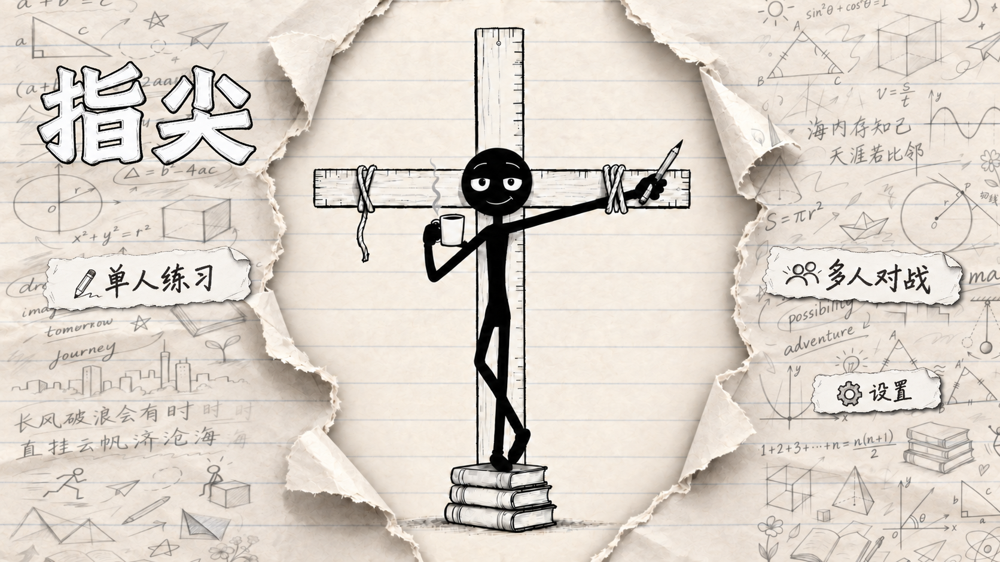
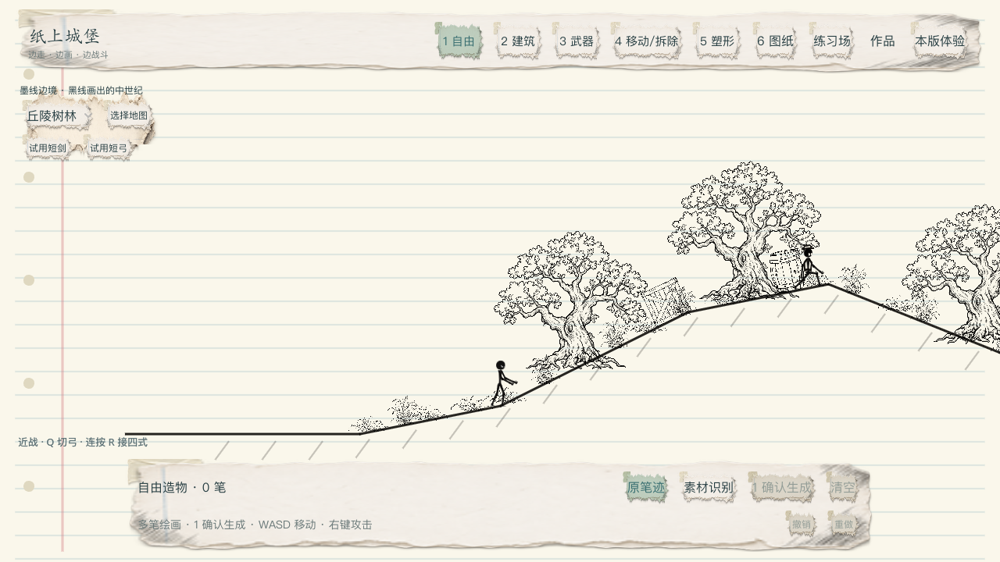
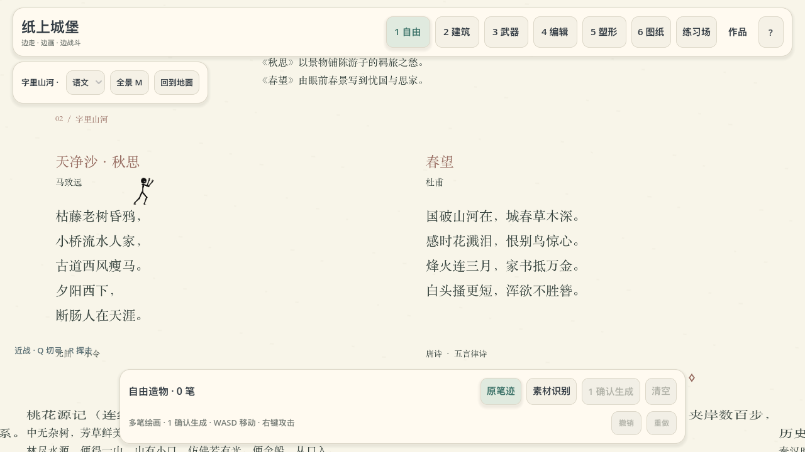
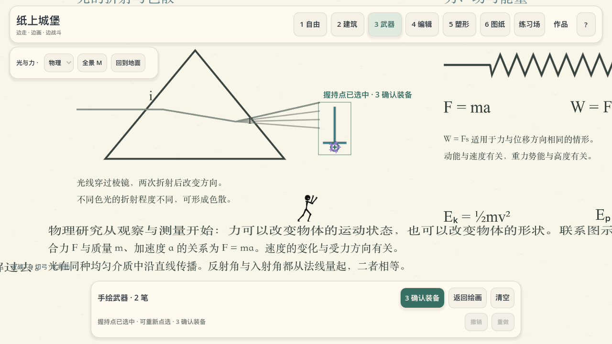
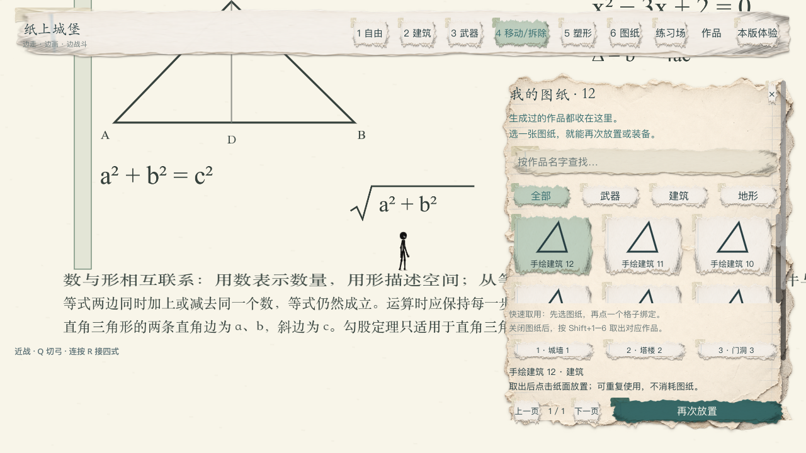
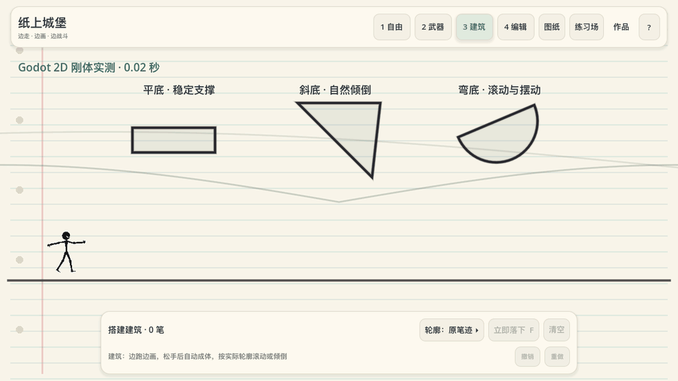
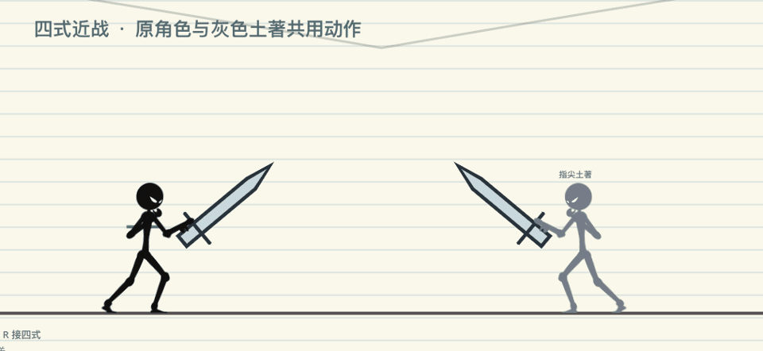
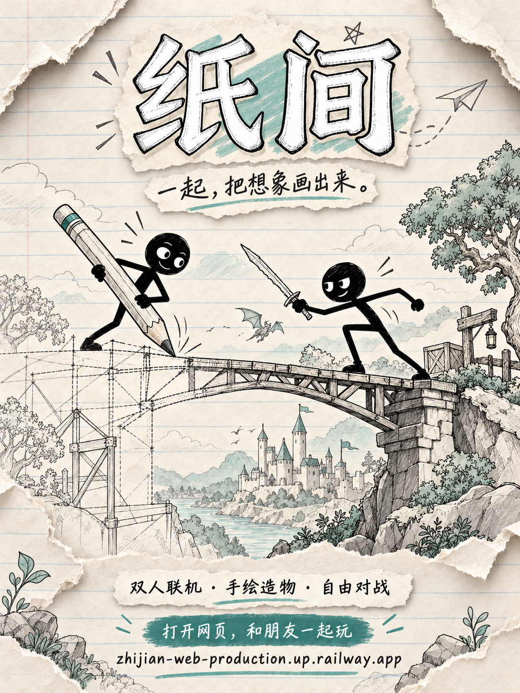

# 指尖

**在纸上画下想象，让它成为世界的一部分。**

2D 手绘造物沙盒 · 火柴人 · 物理搭建 · 纸上冒险

[游戏介绍](#一张纸可以变成什么) · [实机画面](#纸上的世界) · [玩法动图](#让笔迹动起来) · [项目进度](#正在把想象变成游戏) · [海报素材](#海报与素材)

封面延续原有撕纸、课堂草稿与墨线风格，以「指尖」作为新的展示标题。

## 一张纸，可以变成什么？

《指尖》是一款正在开发的 2D 侧视手绘造物沙盒。你控制一个火柴人，在课本与墨线构成的世界里移动、绘画、搭建和交手。

画一座桥，试着走过去；画一把剑，决定握在哪里；画出一个奇怪的轮廓，看它落下、倾倒，又和别的东西碰撞。这里的线条不仅是装饰，也会成为可以使用、保存和再次创造的东西。

> **画下想法 → 确认造物 → 交给物理 → 继续创造。**

| 体验 | 在游戏里做什么 |
| :--- | :--- |
| ✎ 多笔造物 | 反复补画，亲手确认，让完整笔迹进入世界。 |
| ▱ 物理搭建 | 让建筑与自由造物下落、旋转、碰撞和堆叠。 |
| ⚔ 手绘武器 | 在真实笔迹上选握点，挥动自己画出的武器。 |
| ◇ 自动塑形 | 将粗略轮廓规整为几何部件，目前包含 44 种轮廓。 |
| ▤ 图纸收藏 | 保存作品，分类收藏，再次放置建筑或装备武器。 |
| ↟ 纸上探索 | 二连跳、攀墙、穿过平台，走进课本文字与中世纪山野。 |

## 纸上的世界

### 墨线边境

山坡、树林和中世纪场景落在同一张草稿纸上。沿高低路线探索，也可以在世界中继续画下自己的东西。

<table>
  <tr>
    <td width="50%"> <b>字里山河</b> 把诗文、公式与图形变成可探索的课本地图。</td>
    <td width="50%"> <b>把笔迹握在手里</b> 多笔绘制，选择真实握点，再确认装备。</td>
  </tr>
</table>

### 把作品收进图纸

画过的东西值得留下。图纸收藏让建筑与武器可以再次取用，继续搭建下一次想象。

以上均为开发阶段实机截图，部分界面仍显示历史工程名「纸上城堡」。不同截图来自不同开发阶段，最终画面会随迭代更新。

## 让笔迹动起来

<table>
  <tr>
    <td width="50%"> <b>落下之后，交给物理</b> 不同轮廓，有不同的落地方式。</td>
    <td width="50%"> <b>自己画，也自己挥</b> 下劈、反手上挑、前刺与重斩。</td>
  </tr>
</table>

## 正在把想象变成游戏

**当前阶段：开发中。** 这里集中展示游戏概念、美术与阶段性实机内容。

| 模块 | 当前进展 |
| :--- | :--- |
| 核心造物 | 已有本机实现与专项验证：多笔绘画、真实轮廓碰撞、动态搭建、握点与图纸。 |
| 移动与本机战斗 | 已有二连跳、攀墙、平台下穿、四式近战、短弓与交击。 |
| 地图 | 已有课本探索样段和中世纪山野地图，内容与场景持续迭代。 |
| 双人联机 | 已有 Railway 公网 WSS 双客户端验证，以及服务重启后的世界与作者身份恢复验证。 |
| 待继续验收 | 不同网络的两台设备实玩、延迟与拥塞手感、移动端实机及发布包。 |

联机记录来自 2026 年 10 月 24 日的固定验证版本。同一台电脑上的两个公网客户端，与异地两台设备实玩属于不同验证范围；后者仍待完成。当前开发目录的新地图与界面改动也不代表已经部署到云端。

### 基本操作

| 输入 | 操作 |
| :--- | :--- |
| A / D · W / 空格 | 移动与跳跃；可二连跳、贴墙攀爬。 |
| 1 / 2 / 3 | 自由造物 / 建筑 / 武器；再次按当前数字键推进确认。 |
| 4 / 5 / 6 | 移动或拆除 / 自动塑形 / 图纸收藏。 |
| 鼠标左键 | 绘画、选握点、放置或编辑作品。 |
| R / Q | 攻击 / 切换试用短弓与近战武器。 |

武器类型轮盘仍在开发计划中。以上操作介绍不代表所有目标功能均已交付。

## 海报与素材

### 「纸间」联机海报

[查看原尺寸 PNG](media/poster-zhijian-online-20261025.png) · [打开网页版，和朋友一起玩](https://zhijian-web-production.up.railway.app/)

| 内容 | 文件 |
| :--- | :--- |
| 「纸间」联机海报（2026-10-25） | [查看原尺寸 PNG](media/poster-zhijian-online-20261025.png) |
| 「指尖」展示海报 | [查看原尺寸 PNG](media/poster.png) |
| 历史「纸间」封面 | [查看原始封面 PNG](media/cover-original.png) |
| 原封面分层素材 | [八张独立 PNG](media/cover-source/) |
| 游戏截图 | [浏览实机图库](media/screenshots/) |
| 玩法动图 | [浏览 GIF](media/motion/) |
| 素材说明 | [来源与版本记录](MEDIA.md) |

这是项目公开展示仓库，当前提供介绍、海报、截图和动图。可运行版本与下载方式将在后续准备好后更新。

---

**指尖 · 每一笔，都有可能。**

由张天霁创作 · 持续开发中 · 展示记录：2026.10.24

